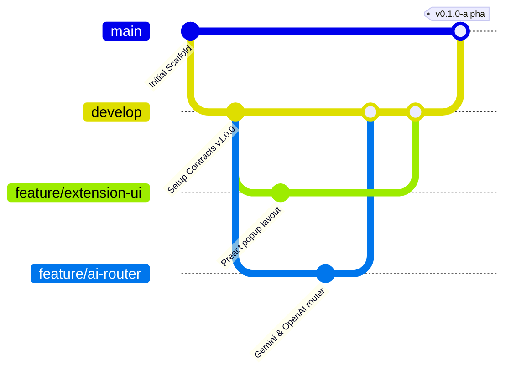

# Antigravity Multi-Agent Collaboration Protocol
**Project:** AlphaDate Personal AI  
**Role:** Rules of Engagement for Antigravity Agents across Machine A and Machine B

---

## 1. Golden Rules of Development

1. **Contracts are Sacred (`packages/contracts`)**:
   * Any change to `packages/contracts` MUST be proposed, discussed, and committed in an isolated PR before any consumer package is updated.
   * Neither agent may unilaterally change existing DTO signatures, message types, or interfaces without explicit cross-agent consensus.

2. **No Duplicate Implementations**:
   * Check existing modules and imports before writing helper functions.
   * If a utility or type belongs to the domain model, it must reside in `@alphadate/contracts`.

3. **Strict Boundary Allocation**:
   To prevent Git merge conflicts, the codebase is partitioned between the two development stations:
   * **Agent 1 (ThinkPad / Developer 1)**:
     - Primary focus: `packages/chrome-extension`, `packages/contracts` (proposals), operator UI (Preact), DOM scraping / Content script integration.
   * **Agent 2 (PC 2 / Developer 2)**:
     - Primary focus: `packages/local-app`, `packages/ai-core`, `packages/model-router`, `packages/memory-manager`, SQLite persistence.
   * *Cross-boundary changes require feature branches and PR review.*

4. **Zero Secrets in Git**:
   * Never commit `.env`, API keys (`GEMINI_API_KEY`, `OPENAI_API_KEY`, etc.), SQLite database files (`*.sqlite`), or personal operator logs.
   * All configuration must be read via environment variables with defaults documented in `.env.example`.

---

## 2. Git Synchronization Workflow for Agents

1. **Branches**:
   * `main`: Protected, production-ready, thoroughly verified code.
   * `develop`: Integration branch where feature branches meet.
   * `feature/<agent>-<feature-name>`: Active working branches (e.g. `feature/dev1-extension-popup`, `feature/dev2-sqlite-schema`).
2. **Before starting any turn**:
   * Always run `git fetch` and `git status`.
   * Keep feature branches short-lived (1–2 tasks maximum).
3. **Commit Messages**:
   * Use Conventional Commits: `feat(scope): ...`, `fix(scope): ...`, `refactor(scope): ...`, `docs(scope): ...`.

---

## 3. Communication Log (`SYNC.md`)

* When an agent finishes a milestone or pushes a branch, it appends an entry to `SYNC.md` with:
  - Date & Agent ID
  - Changed files / packages
  - Contracts touched (if any)
  - Next recommended step for the peer agent
