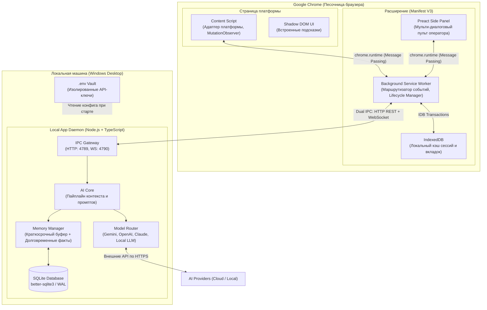

# Архитектурная спецификация: AlphaDate Personal AI

**Роль документа:** Фундаментальная техническая архитектура системы.  
**Главный архитектор:** Lead Architect & Frontend Developer (Агент 1, ThinkPad).  
**Целевая платформа (Этап 1):** Windows 10/11 Desktop + Google Chrome (Manifest V3).  
**Статус:** Утверждено для реализации.

---

## 1. Обзор системы и топология

AlphaDate Personal AI представляет собой гибридную двухуровневую систему, работающую локально на рабочей станции оператора без использования внешних Linux-серверов или облачной серверной инфраструктуры.



---

## 2. Обоснование технического стека

### 2.1 Chrome Extension: Manifest V3
* **Почему Manifest V3:** Единственный актуальный стандарт Google Chrome Web Store. Поддержка Manifest V2 полностью прекращена.
* **Главный вызов:** Фоновые страницы (Background Pages) заменены на **Service Worker**, который принудительно выгружается из памяти браузером после **30 секунд неактивности**.
* **Архитектурное решение проблемы Service Worker:**
  1. **Dual Transport (Двойной транспорт связи с Local Daemon):**
     * **HTTP REST (порт 4789)** для атомарных запросов без сохранения состояния (рукопожатие, разовый анализ сообщения, ручной вызов подсказки). Если воркер «спал», он мгновенно просыпается по событию от интерфейса, шлет быстрый HTTP-запрос и получает ответ.
     * **WebSocket (порт 4790)** для потоковой генерации (streaming) и пуш-уведомлений. Управляется из устойчивого контекста **Side Panel** или восстанавливается сервис-воркером с автоматическим переподключением (Exponential Backoff).
  2. **Персистентность состояния в IndexedDB:** Никаких критических данных в оперативной памяти Service Worker. Любое изменение контекста фиксируется в `IndexedDB`. При перезапуске воркера состояние восстанавливается за < 5 миллисекунд.

### 2.2 UI: Preact + Preact Signals (против тяжелого React)
* **Сравнение:**
  * React 18/19: вес бандла ~140KB+ в сжатом виде, ресурсоемкий Virtual DOM reconciler, накладные расходы по памяти при открытии десятка вкладок.
  * Preact: вес ядра **всего 3.5–4 KB**, 100% совместимость с хуками через `preact/compat`, мгновенный маунт интерфейса (< 30 мс).
* **Preact Signals:** Реактивность на уровне точечных обновлений DOM без лишних ре-рендеров всего дерева компонентов. При быстром потоке входящих сообщений от нескольких собеседников интерфейс оператора не фризит и потребляет минимум CPU.
* **Вердикт:** **Preact + Signals** утверждается как бескомпромиссный стандарт производительности.

### 2.3 Сборщик: Vite
* Мгновенный HMR (Hot Module Replacement) в режиме разработки.
* Многоточечная (multi-entry) сборка Rollup:
  - `src/background/index.ts` -> `dist/background.js` (Service Worker)
  - `src/content/index.ts` -> `dist/content.js` (Content Script)
  - `src/sidepanel/index.html` -> `dist/sidepanel.html` (Панель оператора)
  - `src/popup/index.html` -> `dist/popup.html` (Быстрое меню)
* Чистый tree-shaking, исключающий неиспользуемый код из финального расширения.

### 2.4 Local Application: Node.js (v20+) + TypeScript
* **Почему Node.js:** Высокая скорость разработки, нативная поддержка ESM, богатая экосистема официальных AI SDK (Google GenAI, OpenAI, Anthropic), низкие накладные расходы при работе с сетью и сокетами.
* **SQLite через `better-sqlite3`:**
  - В отличие от асинхронного `sqlite3`, библиотека `better-sqlite3` использует прямое синхронное C++ связывание с V8. Это гарантирует **микросекундный доступ** к данным без блокировки событийного цикла и накладных расходов на промисы.
  - Включение режима **WAL (Write-Ahead Logging)**: чтение и запись происходят параллельно без взаимных блокировок.

### 2.5 Разделение хранилищ: Two-Tier Storage
* **Tier 1 (Browser IndexedDB):** Временный оперативный кэш. Хранит ID открытых вкладок браузера, черновики оператора, активные фильтры UI. Не требует синхронизации при закрытии браузера.
* **Tier 2 (Host SQLite):** Полноценное хранилище. Долговременная память собеседников (факты, предпочтения, история тем), шаблоны оператора, лог работы для аналитики.

---

## 3. Архитектура Chrome Extension

### 3.1 Content Script и DOM-наблюдение
* **Запрет на `setInterval` и полный опрос DOM:** Постоянный опрос дерева DOM через таймеры перегружает вкладки браузера и приводит к утечкам памяти.
* **Стратегия эффективного наблюдения:**
  1. **IntersectionObserver / Ленивая инициализация:** Скрипт не выполняет поиск элементов, пока страница не перейдет в видимое состояние.
  2. **Targeted MutationObserver:** Наблюдение вешается **только** на контейнер ленты сообщений (Message Container).
  3. **Debounce (150–200 мс):** Пакетная обработка входящих узлов DOM. Если собеседник пишет длинное сообщение частями, скрипт ждет стабилизации текста.
  4. **Adapter Pattern:** Логика поиска селекторов вынесена в изолированные адаптеры платформ (`PlatformAdapter`). При изменении верстки сайта обновляется только один файл адаптера, не затрагивая ядро расширения.

### 3.2 Side Panel (Основной рабочий интерфейс оператора)
* Использует стандартный Chrome Side Panel API (`chrome.sidePanel.setOptions`).
* Панель закреплена сбоку экрана и **не закрывается** при клике по страницам (в отличие от Popup).
* Оператор видит активный диалог текущей вкладки и может мгновенно переключаться между другими диалогами без потери набранного текста.

### 3.3 Shadow DOM для встроенных подсказок (In-Page HUD)
* При необходимости вывода подсказок прямо в поле ввода на веб-странице используется **Closed Shadow DOM** (`element.attachShadow({ mode: 'closed' })`).
* Это полностью изолирует стили расширения от стилей сайта и гарантирует, что скрипты страницы не увидят и не перехватят интерфейс ассистента.

---

## 4. Персональный интерфейс оператора (Preact UI)

### 4.1 Мульти-диалоговая модель (Multi-Dialogue)
Оператор одновременно ведет от 3 до 10 диалогов на разных вкладках.
* **Модель контекста (`ActiveDialogueContext`):**
  - При переключении вкладок расширение считывает `tabId` и привязанный `interlocutorId`.
  - Side Panel мгновенно подтягивает:
    1. Карточку собеседника (имя, возраст, статус, ключевые факты из памяти).
    2. Краткую сводку предыдущего общения (Summary).
    3. Анализ последнего входящего сообщения (тональность, скрытый вопрос, триггеры).
    4. 3 варианта ответа с разными тональностями (Остроумный, Заботливый, Флиртующий, Нейтральный).
* **Human-in-the-Loop (Оператор в центре):**
  - Подсказка **никогда не отправляется автоматически**.
  - Оператор может кликнуть на вариант (или нажать горячую клавишу `Alt+1`, `Alt+2`), чтобы текст скопировался в поле ввода страницы для ручной проверки и редактирования.

---

## 5. Архитектура Local Daemon, AI Core и Model Router

### 5.1 Local Application Daemon
* Локальный сервис Node.js, запускающийся в трее или консоли Windows.
* Обладает собственным HTTP-сервером (порт 4789) и WebSocket-сервером (порт 4790).
* Аутентификация локальных запросов: при первом старте генерируется случайный `LOCAL_APP_SECRET_TOKEN`, который сохраняется в локальной конфигурации и используется расширением для защиты от сторонних сайтов (`Host: 127.0.0.1`, заголовок `X-AlphaDate-Token`).

### 5.2 Model Router (Маршрутизатор с каскадом отказоустойчивости)
* Поддерживает унифицированный интерфейс провайдеров (`IModelProvider`).
* **Каскад приоритетов (Fallback Cascade):**
  ```
  1. Google Gemini 1.5/2.0 Flash (Основной: высокая скорость, низкая стоимость, отличное качество диалога)
     |--> В случае сетевой ошибки, 429 Rate Limit или отсутствия ключа:
  2. OpenAI GPT-4o-mini (Второй резерв)
     |--> В случае сбоя внешнего интернета:
  3. Local LLM / Ollama (Локальная модель на ПК оператора — полная автономность)
  ```

### 5.3 Memory Manager (Двухуровневая память)
1. **Short-Term Memory (Скользящее окно):** Последние 10 сообщений активного диалога передаются в контекст промпта как сырой чат.
2. **Long-Term Memory (Ассоциативные факты):**
   - Факты хранятся в SQLite в нормализованном виде: `{ profileId, category, key, value, confidence }`.
   - При генерации подсказки из базы извлекаются факты именно об этом человеке (любимый кофе, имя собаки, работа, город, табу-темы) и инжектируются в System Prompt в виде лаконичного списка.

---

## 6. Бюджеты производительности и ограничения

| Параметр | Лимит для Chrome Extension | Лимит для Local Daemon |
|---|---|---|
| **RAM (Оперативная память)** | < 35 MB в покое, < 60 MB под нагрузкой | < 65 MB в покое, < 120 MB под нагрузкой |
| **CPU (Простой)** | 0.0% (полная тишина при отсутствии ввода) | 0.0% |
| **CPU (Прием сообщения)** | < 3% на всплеске (не более 50 мс) | < 5% (генерация выполняется на стороне LLM API) |
| **Время отклика UI** | < 16 мс (60 FPS анимации) | — |
| **Задержка ответа подсказки** | — | < 800–1200 мс (включая стриминг от API) |

---

## 7. Безопасность и этические стандарты

1. **Изоляция секретов:** Ни один API-ключ не хранится в коде Chrome Extension и не попадает в браузерные логи. Ключи находятся исключительно в файле `.env` на диске оператора и используются только демоном.
2. **Защита от сканирования:** Локальный порт демона слушает **строго `127.0.0.1`** (петлевой интерфейс), закрыт от внешних подключений по локальной сети и защищен валидацией Origin и X-Token.
3. **Этика операторской работы:** Система является **интеллектуальным ассистентом (copilot)**, а не спам-ботом. Полностью исключена скрытая автономная рассылка или автоматическая отправка без ведома оператора.
