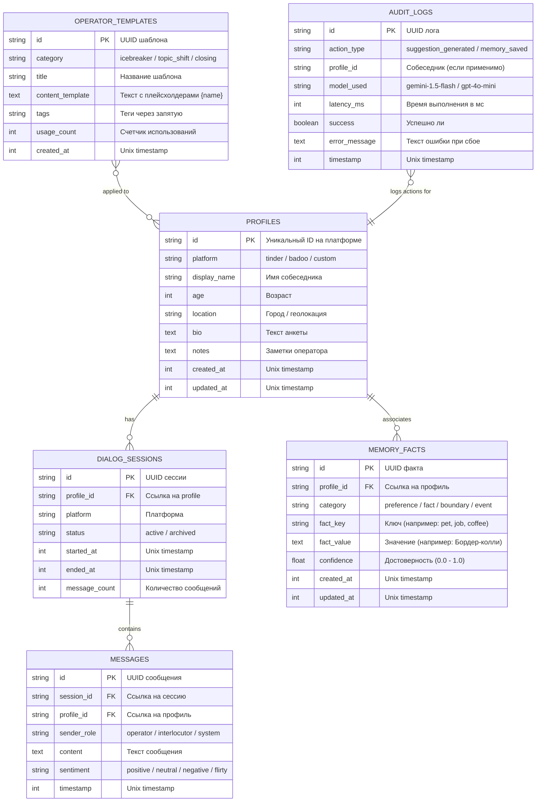

# Модели данных и схема хранилищ: AlphaDate Personal AI

**Статус:** Утвержденная схема постоянных (SQLite) и оперативных (IndexedDB) хранилищ.  
**Главный архитектор:** Lead Architect (Агент 1).  
**Исполнитель реализации SQLite:** Backend Developer (Агент 2).

---

## 1. Диаграмма сущностей (Entity-Relationship Diagram)



---

## 2. Спецификация постоянного хранилища: SQLite (Host Daemon)

* **Файл БД:** `storage/data/alphadate.sqlite`
* **Движок подключения:** `better-sqlite3`
* **Обязательные PRAGMA при инициализации подключения:**
  ```sql
  PRAGMA journal_mode = WAL;          -- Параллельное чтение и запись
  PRAGMA synchronous = NORMAL;        -- Высокая скорость без риска повреждения при краше
  PRAGMA foreign_keys = ON;           -- Контроль внешних ключей
  PRAGMA busy_timeout = 5000;         -- 5 секунд ожидания при конкурентном доступе
  ```

### 2.1 DDL Схема создания таблиц

```sql
-- 1. Таблица профилей собеседников
CREATE TABLE IF NOT EXISTS profiles (
    id TEXT PRIMARY KEY,
    platform TEXT NOT NULL,
    display_name TEXT NOT NULL,
    age INTEGER,
    location TEXT,
    bio TEXT,
    notes TEXT,
    created_at INTEGER NOT NULL,
    updated_at INTEGER NOT NULL
);

CREATE INDEX IF NOT EXISTS idx_profiles_platform ON profiles(platform);
CREATE INDEX IF NOT EXISTS idx_profiles_updated ON profiles(updated_at DESC);

-- 2. Сессии диалогов
CREATE TABLE IF NOT EXISTS dialog_sessions (
    id TEXT PRIMARY KEY,
    profile_id TEXT NOT NULL,
    platform TEXT NOT NULL,
    status TEXT CHECK(status IN ('active', 'archived')) NOT NULL DEFAULT 'active',
    started_at INTEGER NOT NULL,
    ended_at INTEGER,
    message_count INTEGER NOT NULL DEFAULT 0,
    FOREIGN KEY(profile_id) REFERENCES profiles(id) ON DELETE CASCADE
);

CREATE INDEX IF NOT EXISTS idx_sessions_profile ON dialog_sessions(profile_id);

-- 3. Сообщения диалогов
CREATE TABLE IF NOT EXISTS messages (
    id TEXT PRIMARY KEY,
    session_id TEXT NOT NULL,
    profile_id TEXT NOT NULL,
    sender_role TEXT CHECK(sender_role IN ('operator', 'interlocutor', 'system', 'ai_assistant')) NOT NULL,
    content TEXT NOT NULL,
    sentiment TEXT,
    timestamp INTEGER NOT NULL,
    FOREIGN KEY(session_id) REFERENCES dialog_sessions(id) ON DELETE CASCADE,
    FOREIGN KEY(profile_id) REFERENCES profiles(id) ON DELETE CASCADE
);

CREATE INDEX IF NOT EXISTS idx_messages_profile_time ON messages(profile_id, timestamp ASC);

-- 4. Долговременная память и факты
CREATE TABLE IF NOT EXISTS memory_facts (
    id TEXT PRIMARY KEY,
    profile_id TEXT NOT NULL,
    category TEXT CHECK(category IN ('preference', 'personal_fact', 'boundary', 'topic_interest', 'timeline_event')) NOT NULL,
    fact_key TEXT NOT NULL,
    fact_value TEXT NOT NULL,
    confidence REAL NOT NULL DEFAULT 1.0,
    created_at INTEGER NOT NULL,
    updated_at INTEGER NOT NULL,
    FOREIGN KEY(profile_id) REFERENCES profiles(id) ON DELETE CASCADE
);

CREATE INDEX IF NOT EXISTS idx_memory_profile_cat ON memory_facts(profile_id, category);
CREATE UNIQUE INDEX IF NOT EXISTS uq_memory_profile_key ON memory_facts(profile_id, fact_key);

-- 5. Шаблоны ответов оператора
CREATE TABLE IF NOT EXISTS operator_templates (
    id TEXT PRIMARY KEY,
    category TEXT NOT NULL,
    title TEXT NOT NULL,
    content_template TEXT NOT NULL,
    tags TEXT,
    usage_count INTEGER NOT NULL DEFAULT 0,
    created_at INTEGER NOT NULL
);

-- 6. Аудит и метрики работы
CREATE TABLE IF NOT EXISTS audit_logs (
    id TEXT PRIMARY KEY,
    action_type TEXT NOT NULL,
    profile_id TEXT,
    model_used TEXT,
    latency_ms INTEGER NOT NULL,
    success INTEGER NOT NULL,
    error_message TEXT,
    timestamp INTEGER NOT NULL
);

CREATE INDEX IF NOT EXISTS idx_audit_time ON audit_logs(timestamp DESC);
```

---

## 3. Спецификация оперативного хранилища: IndexedDB (Chrome Extension)

* **Имя базы данных:** `AlphaDateClientDB`
* **Версия схемы:** `1`
* **Обертка доступа:** `idb` (легковесная промис-обертка над стандартным IndexedDB).

### 3.1 Object Stores (Таблицы клиента)

#### Store 1: `active_dialogues`
Хранит контекст открытых вкладок браузера для мгновенного восстановления при переключении между вкладками.
* **KeyPath:** `tabId` (целое число — ID вкладки Chrome).
* **Схема объекта:**
```typescript
interface IDBActiveDialogue {
  tabId: number;
  profileId: string;
  platform: string;
  draftText: string;
  interlocutorName: string;
  lastAnalyzedMessageId?: string;
  cachedSuggestions?: SuggestionItem[];
  updatedAt: number;
}
```

#### Store 2: `ui_preferences`
Пользовательские настройки интерфейса в расширении.
* **KeyPath:** `key` (строка).
* **Примеры записей:**
  - `sound_notifications`: `{ key: 'sound_notifications', value: true }`
  - `default_tone`: `{ key: 'default_tone', value: 'witty' }`
  - `hotkey_quick_insert`: `{ key: 'hotkey_quick_insert', value: 'Alt+1' }`

#### Store 3: `offline_queue`
Очередь сообщений, которые не удалось отправить демону, если он был временно перезагружен.
* **KeyPath:** `id` (автоинкремент / UUID).
* Очищается при восстановлении связи по HTTP/WS.
