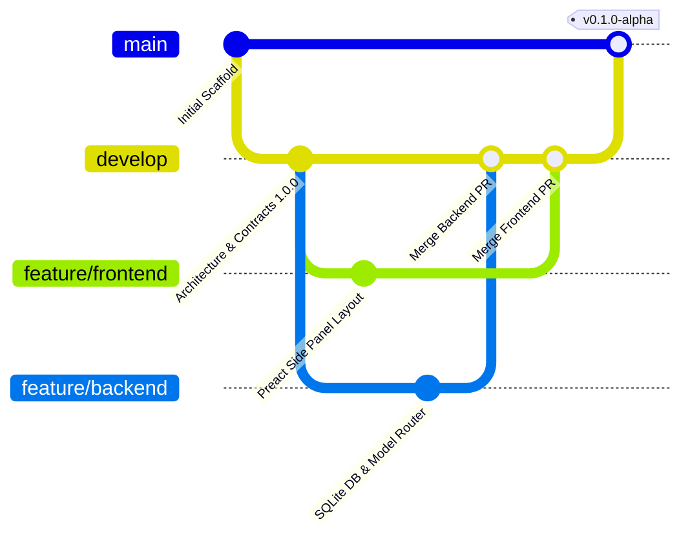

# Руководство по разработке: AlphaDate Personal AI

**Роль документа:** Практическое руководство по организации параллельной разработки для двух Antigravity агентов.  
**Главный разработчик / Архитектор:** Agent 1 (ThinkPad).  
**Backend & AI Core разработчик:** Agent 2 (PC 2).

---

## 1. Распределение ответственности

| Область | Ответственный разработчик | Основные пакеты |
|---|---|---|
| **Общая архитектура и стандарты** | **Agent 1 (Lead Architect)** | Корневые конфиги, `ARCHITECTURE.md`, `CONTRACTS.md` |
| **Общие контракты (`@alphadate/contracts`)** | **Agent 1** (с согласованием PR) | `packages/contracts` |
| **Frontend & Расширение браузера** | **Agent 1** | `packages/chrome-extension` |
| **Интерфейс оператора (Preact UI)** | **Agent 1** | `packages/chrome-extension/src/sidepanel` |
| **Интеграция с DOM веб-страниц** | **Agent 1** | `packages/chrome-extension/src/content` |
| **Local Application Daemon** | **Agent 2 (Backend)** | `packages/local-app` |
| **База данных SQLite и миграции** | **Agent 2** | `packages/local-app/src/db` |
| **AI Core (Prompt Pipeline)** | **Agent 2** | `packages/ai-core` |
| **Model Router (Gemini, OpenAI, Local)**| **Agent 2** | `packages/model-router` |
| **Memory Manager (Краткосрочный + Факты)**| **Agent 2** | `packages/memory-manager` |

---

## 2. Регламент работы с Git



### 2.1 Правила веток
1. **`main`**: Только стабильные проверенные релизы. Прямые коммиты запрещены.
2. **`develop`**: Интеграционная ветка. Вся совместная работа сливается сюда через Pull Requests.
3. **`feature/frontend`**: Рабочая ветка Агента 1 (Lead Architect / Extension).
4. **`feature/backend`**: Рабочая ветка Агента 2 (Backend / AI Core / SQLite).
5. При необходимости разовых правок создаются ветки вида:
   - `feature/dev1-<name>`
   - `feature/dev2-<name>`
   - `contract/<proposal-name>` (для предложений по правке `@alphadate/contracts`).

### 2.2 Процесс слияния изменений (Pull Request Checklist)
Перед открытием PR и перед слиянием в `develop`:
* [ ] Выполнен `npm run typecheck` во всех затронутых пакетах — 0 ошибок.
* [ ] Нет изменений в `packages/contracts`, которые не были предварительно согласованы.
* [ ] В коммитах отсутствуют файлы `.env`, `*.sqlite`, `*.log`, ключи доступа или персональные данные.
* [ ] В файл `SYNC.md` внесена запись с описанием сделанных изменений и инструкцией для напарника.

---

## 3. Чек-лист для Агента 2 (Backend & AI Core)

При реализации своей части на ПК 2 соблюдай следующие правила:

1. **Импорт контрактов:**
   * Всегда используй интерфейсы из `@alphadate/contracts`. Никаких локальных `interface Message` или `interface SuggestionPayload`.
2. **База данных SQLite:**
   * Разверни таблицы строго в соответствии со схемой в `DATA_MODELS.md`.
   * Используй библиотеку `better-sqlite3`.
   * Все запросы должны быть параметризованными (через `stmt.run(param1, param2)` или `stmt.get(...)`), никакой конкатенации SQL-строк.
   * Обязательно активируй WAL-режим: `db.pragma('journal_mode = WAL');`.
3. **Model Router:**
   * Реализуй отказоустойчивый каскад:
     - Основной: Google Gemini 1.5 Flash (через `@google/genai` или `@google/generative-ai`).
     - Резервный: OpenAI GPT-4o-mini (через `openai`).
     - Локальный: Ollama на `http://127.0.0.1:11434` (если доступен).
   * Если провайдер возвращает ошибку 429 (Rate Limit) или 5xx, роутер обязан автоматически переключиться на следующий доступный без падения демона.
4. **Локальный порт и безопасность:**
   * Демон обязан слушать `127.0.0.1` (НЕ `0.0.0.0`).
   * Проверяй заголовок `X-AlphaDate-Token` во всех HTTP-запросах, кроме `/health`.

---

## 4. Команды для локальной проверки

```bash
# 1. Установка зависимостей монорепозитория
npm install

# 2. Сборка пакета контрактов (всегда собирается первым)
npm run --workspace=@alphadate/contracts build

# 3. Полная проверка типов всего проекта
npm run typecheck

# 4. Запуск демона локального приложения в режиме разработки
npm run --workspace=@alphadate/local-app start
```
